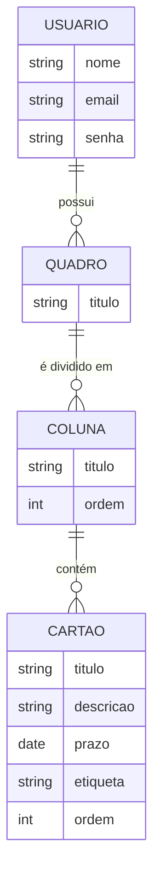
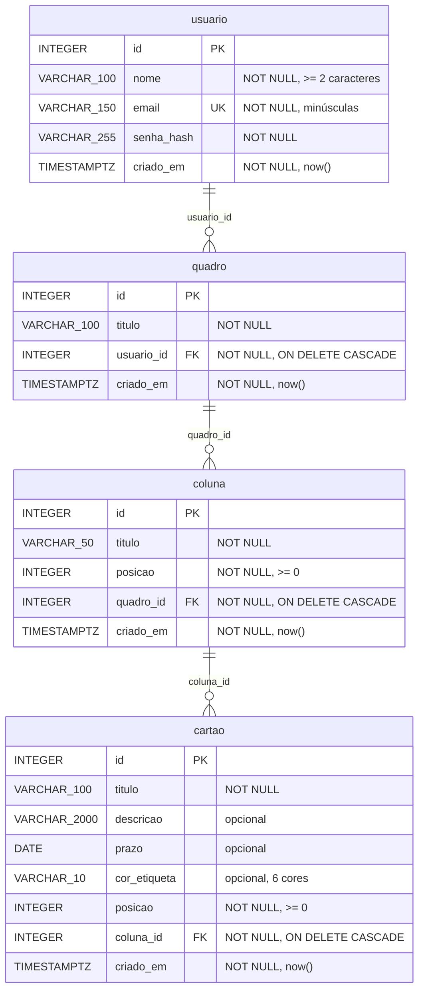

# Modelo de dados: AirPlan

Este documento apresenta o banco de dados em três níveis: **conceitual** (o que o sistema guarda), **lógico** (tabelas, chaves e tipos) e **físico** (o script SQL do PostgreSQL). O detalhamento de cada coluna está no [dicionário de dados](dicionario-de-dados.md).

---

## 1. Modelo conceitual

O AirPlan organiza tarefas em uma hierarquia de quatro entidades. Cada nível pertence a **exatamente um** registro do nível acima:

- Um **Usuário** possui zero ou muitos **Quadros** ("planos de voo").
- Um **Quadro** é dividido em zero ou muitas **Colunas** (etapas: Embarque, Em voo, Pousou…).
- Uma **Coluna** contém zero ou muitos **Cartões** (tarefas).

**Regras que o modelo garante:**

1. Quadros não são compartilhados: cada um tem um único dono.
2. Ao apagar algo, tudo que está "dentro" dele também é apagado (usuário → quadros → colunas → cartões).
3. A ordem das colunas no quadro e dos cartões na coluna é guardada como uma posição numérica contínua (0, 1, 2…).

---

## 2. Modelo lógico (relacional, normalizado até a 3FN)

Notação textual:

- **usuario** (<u>id</u>, nome, email, senha_hash, criado_em)
- **quadro** (<u>id</u>, titulo, *usuario_id* → usuario, criado_em)
- **coluna** (<u>id</u>, titulo, posicao, *quadro_id* → quadro, criado_em)
- **cartao** (<u>id</u>, titulo, descricao, prazo, cor_etiqueta, posicao, *coluna_id* → coluna, criado_em)

### Por que está normalizado

| Forma normal | Como o modelo atende |
|---|---|
| **1FN** | Todos os atributos são atômicos: um cartão tem uma única etiqueta e um único prazo; não há listas dentro de um campo. |
| **2FN** | Todas as chaves primárias são simples (`id`), então não existe dependência de parte da chave. |
| **3FN** | Nenhum atributo depende de outro atributo não-chave. Totais como "quantidade de cartões do quadro" **não são guardados**: são calculados com `COUNT` na hora da consulta, sem risco de ficarem desatualizados. |

### Decisões de modelagem

- **Chave substituta (`id` identity)** em vez de chave natural: o título de um quadro pode se repetir e mudar a qualquer momento.
- **`posicao` inteira e contínua:** a reordenação (arrastar e soltar) acontece em uma transação que renumera a coluna de origem e a de destino, sem deixar lacunas.
- **Cor da etiqueta como texto com `CHECK`** em vez de uma tabela de cores: as 6 cores são fixas, fazem parte do design e não são cadastráveis pelo usuário.
- **Exclusão em cascata (`ON DELETE CASCADE`):** apagar um quadro apaga suas colunas e cartões no próprio banco, sem registros órfãos.

---

## 3. Modelo físico

O modelo físico é o script [`database/schema.sql`](../../database/schema.sql), que cria as tabelas no PostgreSQL 16+ com:

- tipos e tamanhos exatos (`VARCHAR(100)`, `DATE`, `TIMESTAMPTZ`…);
- restrições `NOT NULL`, `UNIQUE`, `CHECK` e chaves estrangeiras com `ON DELETE CASCADE`;
- índices compostos para listar colunas e cartões já ordenados (`quadro_id, posicao` e `coluna_id, posicao`);
- *Row Level Security* ligado sem políticas, bloqueando o acesso direto pela API automática do Supabase. Só o back-end Flask acessa o banco.

Os dados de exemplo (conta de demonstração e 3 quadros) estão em [`database/seed.sql`](../../database/seed.sql).
