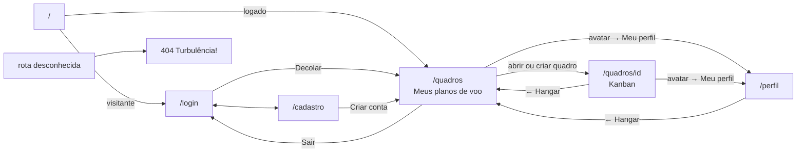

# Protótipo de telas

## Melhoria contínua (Kaizen) em relação ao PIT I

No PIT I, a ideia do projeto foi planejada no papel. Para o PIT II ela foi revista e consolidada: o AirPlan virou um gerenciador de tarefas Kanban, com identidade visual de céu e aviação, escopo fechado (sem compartilhamento, sem anexos) e foco em uma experiência simples de **arrastar cartões entre etapas**. Este documento registra o protótipo usado como referência para a codificação.

## Ferramenta e arquivos

O protótipo navegável foi feito no **Claude Design** e está na pasta [`prototipo/`](../../prototipo/) do repositório. Para abrir:

```bash
npm run prototipo
# abrir http://localhost:8000/AirPlan%20App.dc.html
```

| Arquivo | Tela |
|---|---|
| `AirPlanAuth.dc.html` | Login e Cadastro |
| `AirPlanHangar.dc.html` | Meus planos de voo + modais Novo/Renomear quadro |
| `AirPlanKanban.dc.html` | Quadro Kanban + detalhe do cartão + arrastar e soltar |
| `AirPlanPerfil.dc.html` | Meu perfil |
| `AirPlan404.dc.html` | Página não encontrada |
| `AirPlanHeader.dc.html`, `AirPlanToast.dc.html`, `AirPlanConfirmar.dc.html` | Componentes reutilizados |
| `AirPlanGuia.dc.html` | Guia de estilo (cores, tipografia, componentes) |

## Mapa de navegação



## Guia visual

| Elemento | Definição |
|---|---|
| Fonte | Nunito (400, 600, 700, 800) |
| Cor primária | `#1F6FC9` (hover `#185AA3`) |
| Céu | gradiente de `#5AB2F0` a `#E8F5FF` |
| Etiquetas | verde `#2EAD6B`, amarelo `#F5C524`, laranja `#F5822A`, vermelho `#E5484D`, roxo `#8B5CF6`, azul `#1F6FC9` |
| Selo de prazo | normal (cinza), vence em até 2 dias (amarelo), atrasado (vermelho) |
| Responsividade | desktop ≥ 1024 px (4 quadros por linha), tablet 768–1023 (2), celular < 768 (1; Kanban com uma coluna por vez) |

## Telas implementadas

As telas finais do app, fiéis ao protótipo, estão no [manual de uso](../situacao-2/manual-de-uso.md). Alguns exemplos:

| Login | Meus planos de voo |
|---|---|
|  |  |

| Quadro Kanban | Detalhe do cartão |
|---|---|
|  |  |
