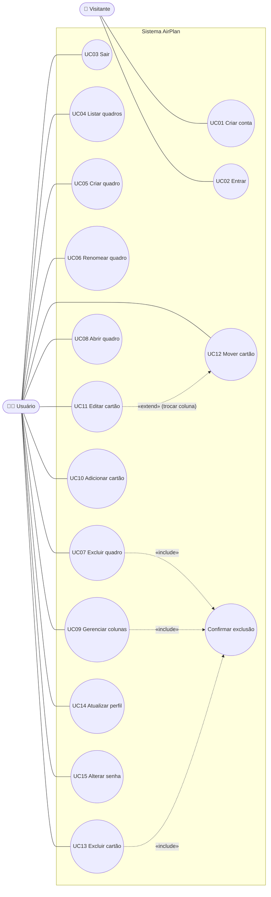

# UML: Diagrama de casos de uso

O AirPlan tem dois atores:

- **Visitante:** pessoa ainda não identificada no sistema.
- **Usuário:** pessoa logada. Só enxerga e altera os próprios quadros.

> O Mermaid não tem um tipo próprio para casos de uso; o diagrama acima segue a notação UML (atores, elipses, fronteira do sistema, «include» e «extend») usando um fluxograma.

---

## Descrição dos casos de uso

| ID | Caso de uso | Ator | Pré-condição | Fluxo principal | Fluxos alternativos / regras |
|---|---|---|---|---|---|
| UC01 | Criar conta | Visitante | Não estar logado | Informa nome, e-mail, senha e confirmação → o sistema valida, cria a conta e já inicia a sessão | E-mail já cadastrado (409); senha sem letra/número ou com menos de 8 caracteres; senhas diferentes |
| UC02 | Entrar | Visitante | Ter conta | Informa e-mail e senha → o sistema confere e abre "Meus planos de voo" | E-mail ou senha incorretos: alerta único, sem revelar qual dos dois está errado |
| UC03 | Sair | Usuário | Estar logado | Escolhe "Sair" → a sessão é encerrada e volta ao login | — |
| UC04 | Listar quadros | Usuário | Estar logado | O sistema mostra os quadros do usuário com total de colunas e cartões | Nenhum quadro: estado vazio com o mascote; falha de rede: "Tentar novamente" |
| UC05 | Criar quadro | Usuário | Estar logado | Informa o título → o quadro é criado com as colunas Embarque, Em voo e Pousou e é aberto | Título vazio ou com mais de 100 caracteres |
| UC06 | Renomear quadro | Usuário | Ser dono do quadro | Altera o título (no Hangar ou no topo do Kanban) | Título vazio: mantém o anterior e avisa |
| UC07 | Excluir quadro | Usuário | Ser dono do quadro | Pede a exclusão → confirma → o quadro some com suas colunas e cartões | Cancelar mantém tudo |
| UC08 | Abrir quadro | Usuário | Ser dono do quadro | O sistema exibe as colunas e os cartões em ordem | Quadro de outro usuário ou inexistente: página 404 |
| UC09 | Gerenciar colunas | Usuário | Ser dono do quadro | Cria (vai para o fim), renomeia ou exclui colunas | Exclusão reordena as restantes; texto de confirmação no singular/plural |
| UC10 | Adicionar cartão | Usuário | Ser dono do quadro | Digita o título no fim da coluna → o cartão entra no fim | Título vazio é ignorado |
| UC11 | Editar cartão | Usuário | Ser dono do quadro | Altera título, descrição, prazo, etiqueta e/ou coluna → salva | Fechar com alterações pergunta "Descartar alterações?" |
| UC12 | Mover cartão | Usuário | Ser dono do quadro | Arrasta o cartão para outra posição ou coluna (ou usa "Mover para") | Falha na API: o cartão volta à posição original; coluna de outro quadro é recusada |
| UC13 | Excluir cartão | Usuário | Ser dono do quadro | Pede a exclusão no detalhe do cartão → confirma | A coluna é reordenada |
| UC14 | Atualizar perfil | Usuário | Estar logado | Altera o nome → salva | O e-mail não pode ser alterado |
| UC15 | Alterar senha | Usuário | Estar logado | Informa senha atual, nova e confirmação → salva | Senha atual incorreta; nova igual à atual |
