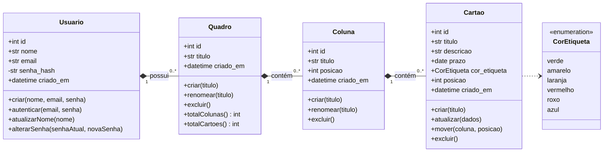
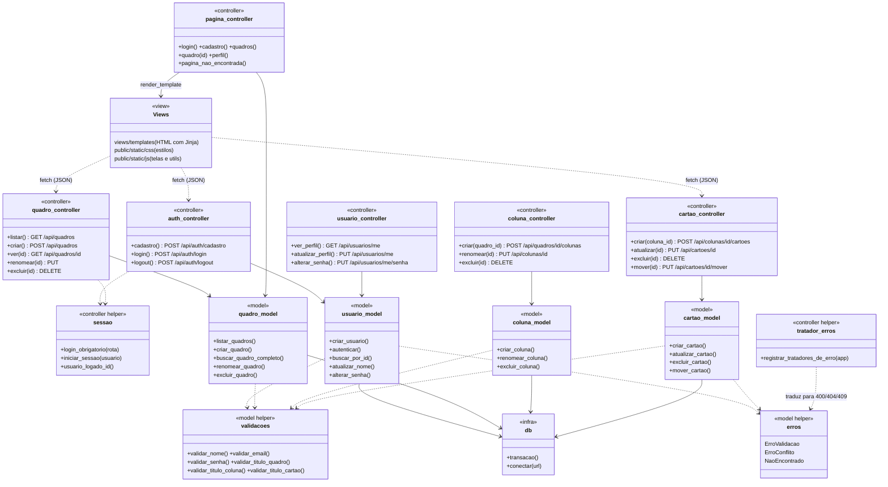

# UML: Diagrama de classes

## 1. Classes do domínio

As entidades do negócio e seus relacionamentos. No código não há ORM: cada entidade é uma tabela do banco, e as operações ficam nas funções do *model* correspondente (próxima seção).

A **composição** (losango cheio) indica que a parte não existe sem o todo: excluir um quadro exclui suas colunas e cartões.

---

## 2. Classes da arquitetura (MVC)

Como o back-end é escrito em Python com funções (sem classes de entidade), cada **módulo** aparece abaixo como uma classe com estereótipo. A separação mostra o padrão MVC exigido:

- **Model:** SQL e regras de negócio. Não conhece HTTP.
- **Controller:** recebe a requisição, chama o model e devolve JSON ou HTML. Não escreve SQL.
- **View:** templates HTML, CSS e JavaScript.

