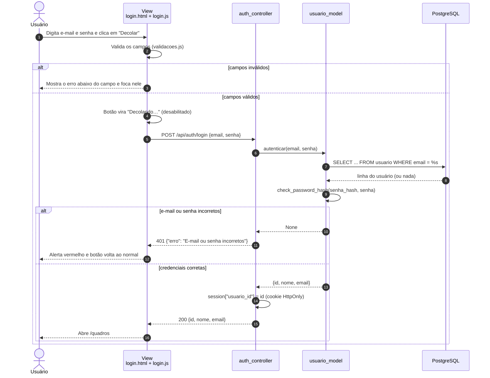
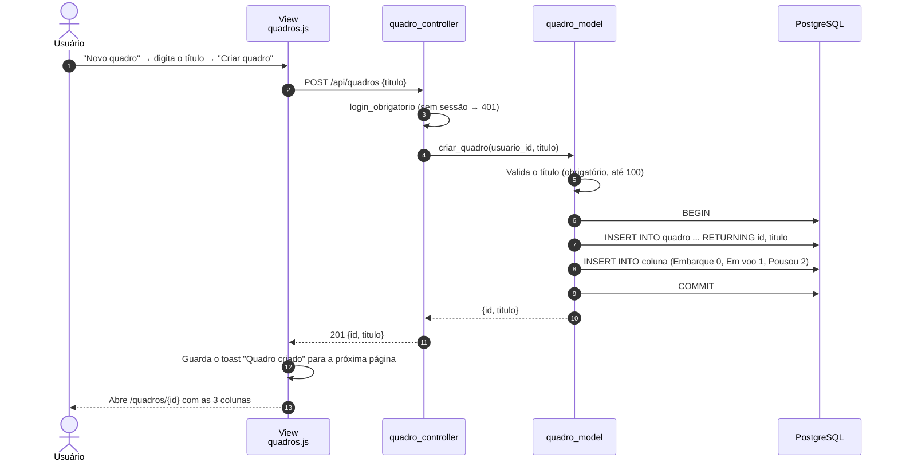
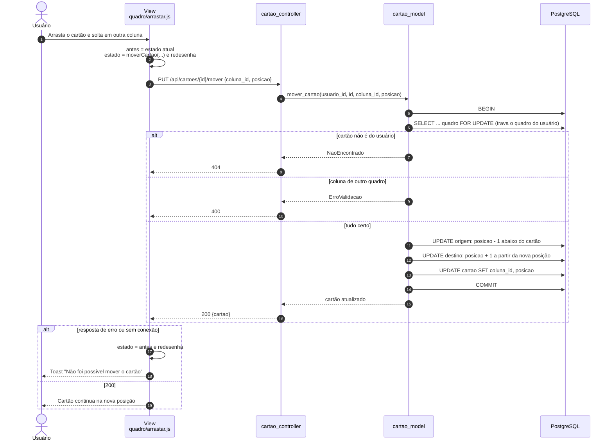

# UML: Diagramas de sequência

Três fluxos que mostram as camadas do MVC conversando: **View** (navegador) → **Controller** (Flask) → **Model** (SQL) → **PostgreSQL**.

---

## 1. Entrar no sistema (UC02)

---

## 2. Criar um quadro (UC05)

---

## 3. Mover um cartão arrastando (UC12)

O movimento é **otimista**: a tela muda na hora e só volta atrás se a API falhar.

