# Manual de uso: AirPlan ✈️☁️

> *Organize suas tarefas com a leveza de arrastar um cartão.*

O AirPlan é um gerenciador de tarefas no estilo Kanban. Você monta **planos de voo** (quadros), divididos em **colunas** (as etapas da tarefa) que guardam **cartões** (as tarefas). Conforme o trabalho anda, você arrasta os cartões de uma coluna para outra, por exemplo de **Embarque** para **Em voo** e de **Em voo** para **Pousou**.

---

## 1. Como acessar

- **Endereço:** `https://<link-do-app-no-render>` *(o link definitivo entra aqui depois do deploy)*
- **Navegadores testados:** Chrome, Edge e Firefox atualizados, no computador e no celular.
- **Conta de demonstração:** e-mail `lucas@email.com`, senha `voo12345`.

> ⏳ **O primeiro acesso pode demorar cerca de 1 minuto.** O servidor gratuito (Render) "dorme" depois de 15 minutos sem uso e precisa acordar. Depois disso, o app responde normalmente.

---

## 2. Criar conta e entrar

### Criar conta
1. Na tela de login, clique em **Criar conta**.
2. Preencha **Nome**, **E-mail**, **Senha** e **Confirmar senha**.
   - A senha precisa ter **no mínimo 8 caracteres, com letras e números**.
   - A barrinha abaixo da senha mostra se ela está **fraca**, **média** ou **forte**.
   - O ícone de olho 👁 mostra ou esconde o que você digitou.
3. Clique em **Criar conta**. Você entra direto em **Meus planos de voo** e vê a mensagem *"Bem-vindo a bordo"*.

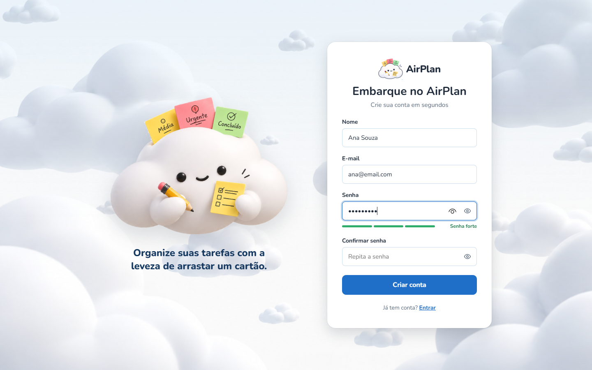

Se algum campo estiver errado, a mensagem aparece em vermelho logo abaixo dele, e o cursor vai para o primeiro campo com problema. Se o e-mail já tiver uma conta, aparece *"Este e-mail já está cadastrado"*.

### Entrar
1. Digite seu **e-mail** e sua **senha**.
2. Clique em **Decolar**.

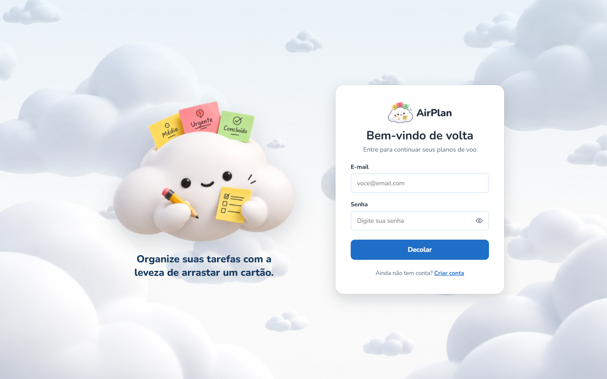

Se o e-mail ou a senha estiverem errados, aparece o aviso *"E-mail ou senha incorretos"*.

---

## 3. Meus planos de voo (Hangar)

É a tela inicial depois do login. Cada cartão grande é um quadro e mostra quantas colunas e quantos cartões ele tem.

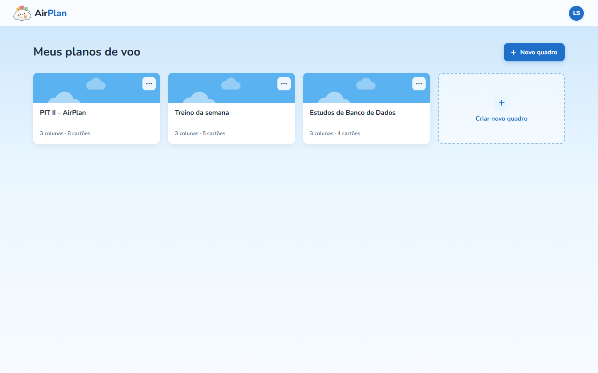

| Para… | Faça assim |
|---|---|
| **Criar um quadro** | Clique em **+ Novo quadro** (ou em **Criar novo quadro**), digite o título e clique em **Criar quadro**. O quadro novo já vem com as colunas **Embarque**, **Em voo** e **Pousou** e abre na hora. |
| **Abrir um quadro** | Clique no quadro (ou selecione-o com Tab e aperte Enter). |
| **Renomear um quadro** | Clique no botão **⋯** do quadro → **Renomear**. |
| **Excluir um quadro** | Clique no botão **⋯** do quadro → **Excluir** → confirme. ⚠️ As colunas e os cartões do quadro também são apagados. |

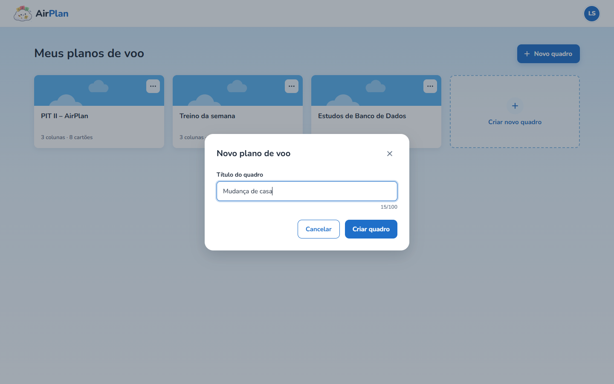

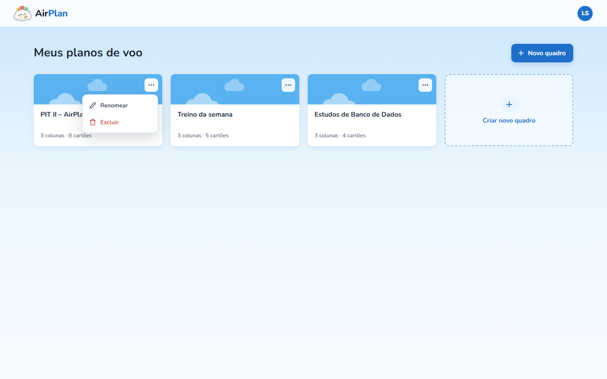

Se você ainda não tem nenhum quadro, a tela mostra o mascote e o botão **Criar meu primeiro quadro**.

---

## 4. Dentro do quadro (Kanban)

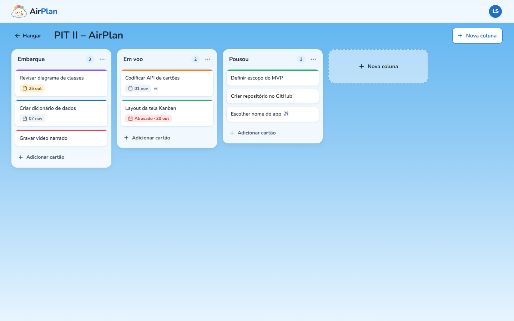

### Título do quadro
Clique no título, no topo da tela, para editá-lo. **Enter** salva e **Esc** cancela. O botão **← Hangar** volta para a lista de quadros.

### Colunas
| Para… | Faça assim |
|---|---|
| **Criar uma coluna** | Clique em **+ Nova coluna** (no topo ou no fim do quadro), digite o título e aperte **Enter** ou clique em **Criar coluna**. Ela entra no fim do quadro. |
| **Renomear** | Clique no título da coluna (ou **⋯** → **Renomear**), digite e aperte **Enter**. |
| **Excluir** | **⋯** → **Excluir coluna** → confirme. Os cartões dela também são apagados. |

O número ao lado do título mostra quantos cartões a coluna tem.

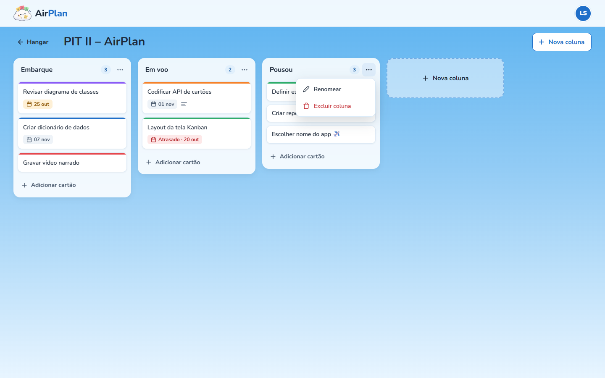

Toda exclusão pede confirmação. O botão **Cancelar** já vem selecionado, para você não apagar nada sem querer.

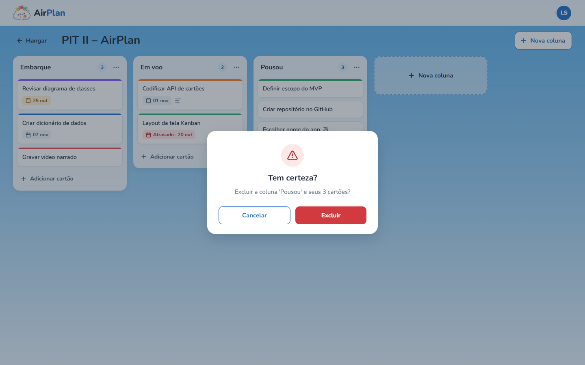

### Cartões (tarefas)
**Adicionar:** clique em **+ Adicionar cartão** no fim da coluna, digite o título e aperte **Enter**. O campo continua aberto para você adicionar o próximo cartão. **Esc** fecha.

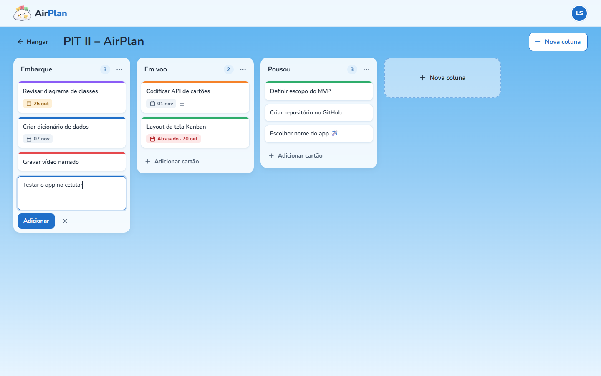

**Mover arrastando (computador):** clique no cartão, segure e arraste até a posição desejada, na mesma coluna ou em outra. Um espaço tracejado mostra onde ele vai cair, e a coluna de destino fica destacada.

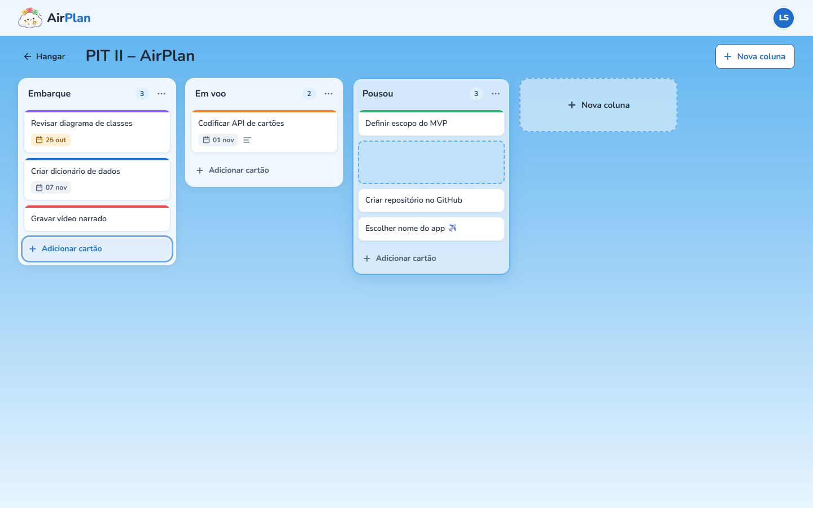

> Se a internet cair bem na hora de soltar, o cartão volta para onde estava e aparece a mensagem *"Não foi possível mover o cartão"*. É só tentar de novo.

**Abrir os detalhes:** clique no cartão (ou selecione-o com Tab e aperte Enter). No detalhe você pode:

- mudar o **título**;
- **mover para** outra coluna (ele vai para o fim dela);
- escrever uma **descrição** (até 2000 caracteres);
- definir ou **remover o prazo**;
- escolher uma **etiqueta** colorida;
- **excluir** o cartão.

Clique em **Salvar** para guardar. Se você fechar com alterações não salvas, o app pergunta se quer **descartar**.

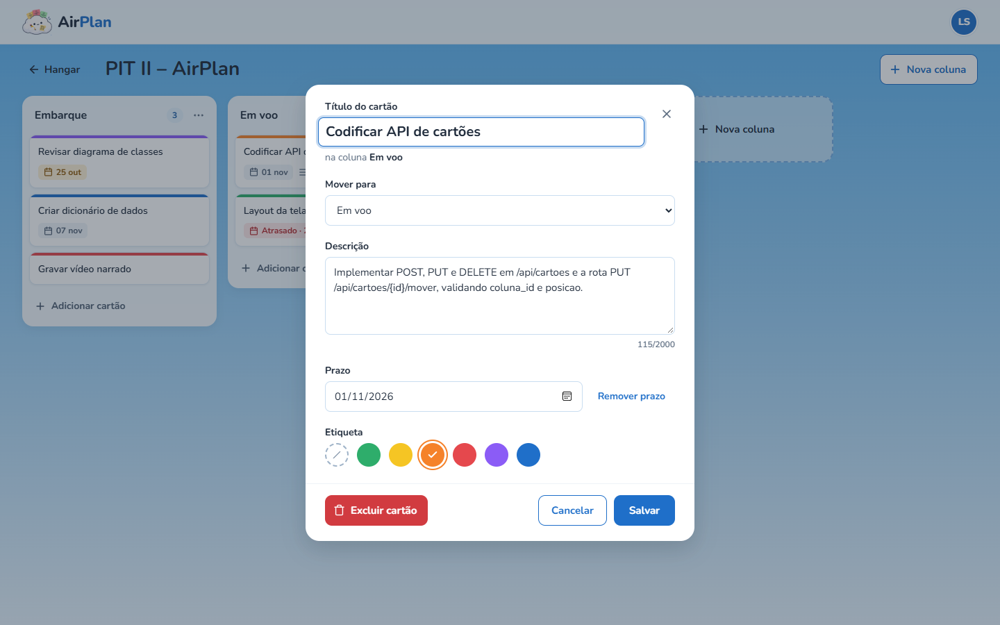

### O que cada sinal do cartão quer dizer
| Sinal | Significado |
|---|---|
| Faixa colorida no topo | Etiqueta escolhida (verde, amarelo, laranja, vermelho, roxo ou azul) |
| 📅 **cinza** "07 nov" | Prazo em dia |
| 📅 **amarelo** "25 out" | Vence em até 2 dias |
| 📅 **vermelho** "Atrasado · 20 out" | O prazo já passou |
| ☰ (três linhas) | O cartão tem descrição |

---

## 5. Meu perfil

Clique no círculo com suas iniciais, no canto superior direito → **Meu perfil**.

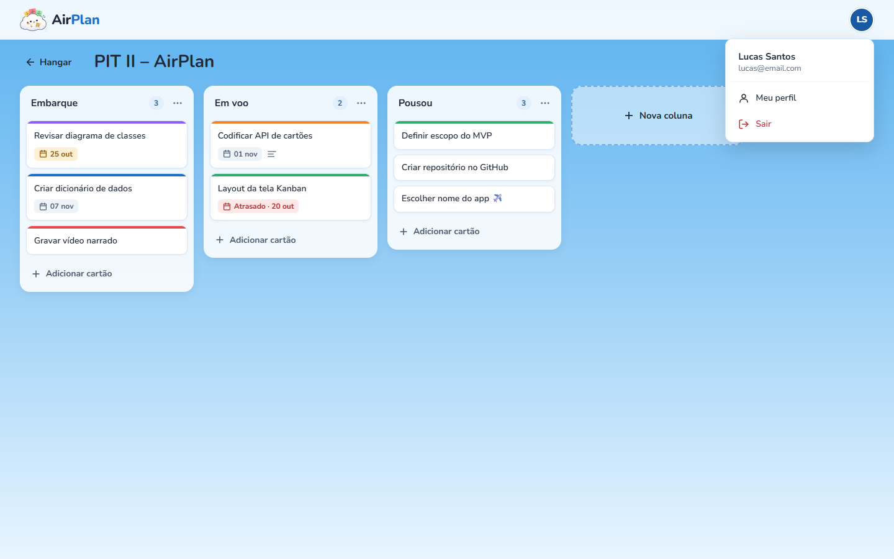

- **Dados pessoais:** altere seu nome e clique em **Salvar alterações**. O e-mail não pode ser alterado.
- **Alterar senha:** informe a senha atual, a nova senha (diferente da atual) e a confirmação.
- **Sair da conta:** encerra a sessão e volta para o login. Também dá para sair pelo menu das iniciais → **Sair**.

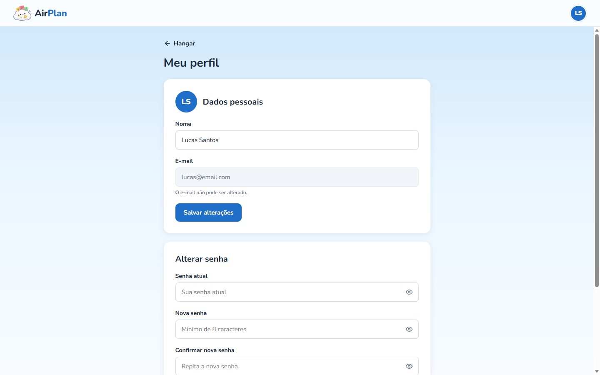

---

## 6. No celular

O AirPlan se adapta à tela:

- os quadros aparecem um embaixo do outro;
- no quadro, você vê **uma coluna por vez** e desliza o dedo para o lado para trocar de coluna. Os pontinhos no topo mostram em qual coluna você está;
- no celular **não existe arrastar**: para mudar um cartão de coluna, abra o cartão e use **Mover para**;
- as janelas (detalhe do cartão, novo quadro) ocupam a tela inteira.

| Meus quadros | Quadro | Mover para |
|---|---|---|
| 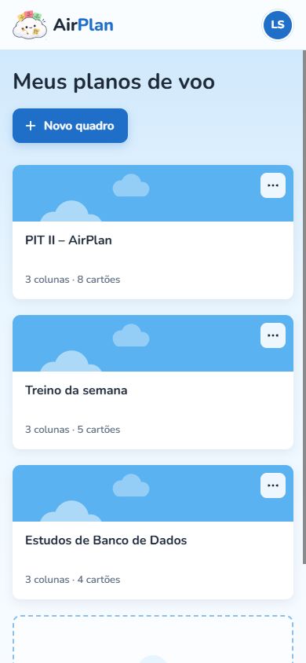 | 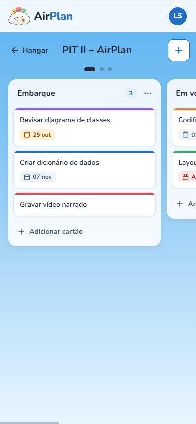 | 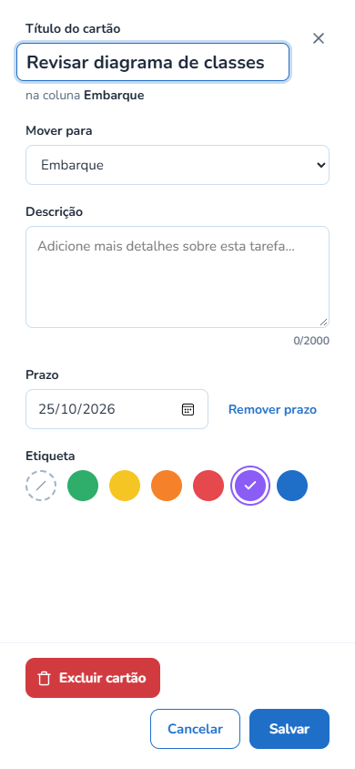 |

---

## 7. Mensagens e situações comuns

| Situação | O que acontece / o que fazer |
|---|---|
| Ficou muito tempo sem usar | A sessão expira e o app volta para o **login**. Entre de novo. |
| *"Não foi possível conectar. Tente novamente."* | Sem internet ou o servidor está acordando. Aguarde alguns segundos e repita. |
| *"Não foi possível carregar seus quadros"* | Clique em **Tentar novamente**. |
| Página **"Turbulência! 🌩️"** (erro 404) | O endereço não existe ou o quadro não é seu. Use o botão para voltar. |

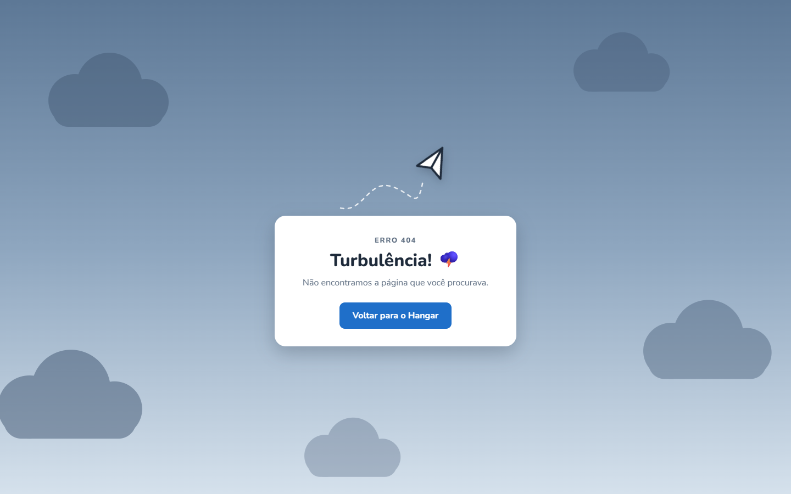

---

## 8. Acessibilidade

- Tudo funciona pelo teclado: **Tab** navega, **Enter** abre e confirma, **Esc** fecha menus e janelas.
- As janelas mantêm o foco dentro delas e, ao fechar, devolvem o foco para onde você estava.
- As cores nunca são a única informação: prazo e etiqueta também aparecem em texto para leitores de tela.
- Se o seu sistema pede **menos movimento**, as animações são desligadas.
